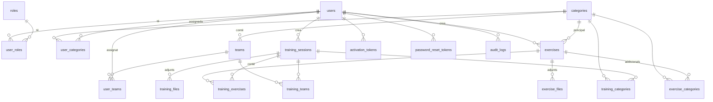

# Entrenaments JSPM

Aplicació web per gestionar entrenadors, categories, equips, exercicis i entrenaments del **Joventut Sant Pere Màrtir**.
PHP 8.4+ nadiu (MVC propi), MySQL 8 / MariaDB, CSS i JavaScript propis. L'única dependència externa és **PHPMailer**.
Tota la interfície, validacions i correus són en català.

## Resum funcional

| Rol | Pot fer |
|---|---|
| **Administrador** | Gestionar entrenadors (alta amb correu d'activació, activar/desactivar, assignar categories i equips), categories, equips, exercicis (amb adjunts), entrenaments (exercicis ordenables, estats, adjunts, notificacions), configurar el SMTP, pujar el logotip, consultar el registre d'activitat i l'historial de correus. |
| **Entrenador** | Activar el compte, iniciar sessió, recuperar/canviar la contrasenya, veure el perfil, les seves categories i equips, **tots els exercicis actius** i els **entrenaments publicats** de les seves categories o equips. |

Estats d'un entrenament: *Esborrany*, *Publicat*, *Cancel·lat*, *Finalitzat*.

## Arquitectura

```
public/index.php  →  Router (app/Services/Router.php)  →  Middleware (csrf, auth, admin, guest)
                  →  Controller (app/Controllers)  →  Models (app/Models, PDO) / Services (app/Services)
                  →  View PHP (app/Views, escapat amb e())
```

* **Un sol punt d'entrada** (`public/index.php`), enrutador propi amb rutes a `routes/web.php`.
* **Helpers** (`app/Helpers`): Env, Config, Db (PDO), Session, Csrf, Crypto (libsodium), Request/Response/View, Paginator.
* **Serveis** (`app/Services`): autenticació i bloqueig, tokens (SHA-256), fitxers, correu (PHPMailer), notificacions, auditoria, gestió d'errors, instal·lador.
* **Seguretat**: consultes preparades, CSRF a tots els POST, CSP estricta (sense scripts ni estils inline), cookies `HttpOnly`/`Secure`/`SameSite=Lax`, regeneració de sessió, caducitat per inactivitat, límit d'intents amb bloqueig temporal, `password_hash`/`password_needs_rehash`, tokens amb `random_bytes` guardats com a hash, contrasenya SMTP xifrada amb `APP_KEY`, fitxers fora de `public/` servits per PHP amb comprovació de permisos, errors genèrics i log tècnic a `storage/logs`.

## Model de dades



Taules addicionals sense relació: `smtp_settings`, `application_settings`, `email_logs`, `login_attempts`.
Script complet: [database/migrations/001_schema.sql](database/migrations/001_schema.sql) i dades inicials a [database/seeds/001_initial_data.sql](database/seeds/001_initial_data.sql).

## Estructura

```
app/Controllers  app/Models  app/Services  app/Middleware  app/Validators  app/Helpers
app/Views (layouts, components, ...)   config/   routes/   database/{migrations,seeds}
public/ (index.php, install.php, assets/)   storage/{uploads,logs}   templates/emails   tests/   bin/
```

## Instal·lació

Requisits: PHP ≥ 8.4 amb `pdo_mysql`, `mbstring`, `fileinfo`, `sodium`, `openssl` (recomanat `zip`, `gd`); MySQL 8 o MariaDB; Apache amb `mod_rewrite` (opcional `mod_deflate`/`mod_expires`); HTTPS en producció.

1. Puja el projecte al servidor i executa `composer install --no-dev` (o puja la carpeta `vendor/`).
2. Configura l'arrel web (DocumentRoot) perquè apunti **només a `public/`**. Si no és possible, el `.htaccess` de l'arrel redirigeix a `public/`.
3. Crea una base de dades buida (utf8mb4) i un usuari amb tots els permisos sobre ella.
4. Obre `https://el-teu-domini/install.php`: comprova els requisits, demana les dades de la BD, genera `.env` amb una `APP_KEY` nova, crea les taules, les categories per defecte i l'usuari administrador, i **bloqueja l'instal·lador** (`storage/installed.lock`).
   Alternativa per terminal: copia `.env.example` a `.env`, omple `DB_*`, i executa `php bin/install.php`.
5. Elimina `public/install.php`.
6. Entra amb l'usuari **`Gestor`** i la contrasenya inicial **`PicdelBac2026`** (definida a `.env.example`). Serà obligatori canviar-la al primer accés. L'instal·lador buida `INITIAL_ADMIN_PASSWORD` del `.env` en acabar; a la BD només hi ha el hash.
7. A *Administració › Configuració del correu* introdueix el SMTP, activa els correus i envia un correu de prova. A *Logotip del club* puja el logotip.

Permisos: `storage/` i `.env` han de ser escrivibles pel servidor web i no accessibles des del web. Les dades sensibles mai es troben sota `public/`.

### Variables `.env` principals

`APP_URL`, `APP_ENV`, `FORCE_HTTPS`, `DB_*`, `APP_KEY` (base64, 32 bytes; **fes-ne còpia**: sense ella no es pot desxifrar la contrasenya SMTP), `SESSION_IDLE_MINUTES`, `LOGIN_MAX_ATTEMPTS`, `LOGIN_LOCK_MINUTES`, `RESET_TOKEN_MINUTES`, `UPLOAD_MAX_MB`, `ALLOW_MP4`, `PER_PAGE`.

## Manual d'ús

**Administrador**
* *Entrenadors › Nou entrenador*: omple les dades i marca categories i equips. Rep un correu amb l'enllaç per definir la contrasenya (d'un sol ús). Des de la fitxa pots *reenviar l'activació* (genera un enllaç nou i invalida els anteriors) o *invalidar els enllaços*.
* *Categories* i *Equips*: crea, edita, ordena, activa/desactiva. Una categoria amb relacions no es pot eliminar (es desactiva).
* *Exercicis*: crea'ls amb categoria principal i addicionals, dades opcionals i fitxers (PDF, JPG, PNG, WEBP, DOCX, XLSX i MP4 si `ALLOW_MP4=true`).
* *Entrenaments*: crea'l com a esborrany, afegeix exercicis del catàleg amb els botons *Puja / Baixa / Treu* (funciona sense JavaScript), duració i observacions per exercici. *Publica* notifica per correu els entrenadors afectats (un sol correu per persona). *Cancel·la* també notifica. En editar un entrenament publicat, els canvis de data/hora es notifiquen sempre; la resta, si marques la casella.
* *Administració*: configuració del correu, logotip, historial de correus i registre d'activitat.

**Entrenador**: activa el compte des del correu, inicia sessió amb el correu i la contrasenya, i consulta el panell, els exercicis (cerca i filtres) i els seus entrenaments. Pot descarregar els adjunts autoritzats.

## Proves

```
php tests/run.php
```
Requereixen l'aplicació instal·lada sobre una **BD de proves** amb `APP_ENV=local` (esborren totes les dades) i l'extensió `curl`. Aixequen un servidor PHP intern i verifiquen: login correcte/incorrecte, bloqueig, canvi obligatori de contrasenya, activació i token d'un sol ús, recuperació i caducitat, permisos admin/entrenador, exercicis globals, restricció d'entrenaments, CSRF, injecció SQL, XSS, pujades vàlides i perilloses, descàrregues autoritzades i no autoritzades, SMTP xifrat, enviament de correus i prevenció de duplicats.

## Criteris tècnics

Sense frameworks ni ORMs, PSR-4 amb Composer, `declare(strict_types=1)`, PSR-12. Només PHPMailer com a dependència.
