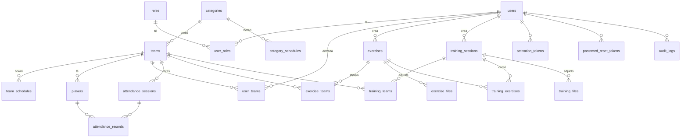

# Entrenaments JSPM

Aplicació web per gestionar entrenadors, categories, equips, jugadors, exercicis, entrenaments i **assistència** del **Joventut Sant Pere Màrtir**. Pensada primer per a mòbil: menú hamburguesa, colors clars i lletres en negre i blau marí.
PHP 8.4+ nadiu (MVC propi), MySQL 8 / MariaDB, CSS i JavaScript propis. L'única dependència externa és **PHPMailer**.
Tota la interfície, validacions i correus són en català.

**Contingut:** [Resum funcional](#resum-funcional) · [Arquitectura](#arquitectura) · [Model de dades](#model-de-dades) · [Desenvolupament local](#desenvolupament-local) · [Instal·lació](#instal·lació) · [Manual d'ús](#manual-dús) · [Proves](#proves)

## Resum funcional

| Rol | Pot fer |
|---|---|
| **Administrador** | Gestionar **equips** (categoria, entrenadors, horari), **jugadors** (alta manual o importació des d'Excel/CSV), el **calendari** (horaris i festius) i veure el **resum de faltes**; gestionar entrenadors (alta amb correu d'activació, activar/desactivar, assignar categories), categories, exercicis (amb adjunts), entrenaments (exercicis ordenables, estats, adjunts, notificacions), configurar el SMTP, pujar el logotip, consultar el registre d'activitat i l'historial de correus. |
| **Entrenador** | **Passar llista** (hi és / ha arribat tard / no hi és) a la fitxa de cada entrenament dels seus equips; activar el compte, iniciar sessió, recuperar/canviar la contrasenya, veure el perfil, les seves categories, **tots els exercicis actius** i els **entrenaments publicats** de les seves categories. |

Estats d'un entrenament: *Esborrany*, *Publicat*, *Cancel·lat*, *Finalitzat*.

## Equips, jugadors i assistència

* **Categoria → Equip → Jugadors.** Un equip pertany a una categoria; un entrenador pot portar diversos equips i un equip pot tenir diversos entrenadors. Els exercicis, entrenaments i notificacions s'assignen a **equips**.
* **Horaris:** cada categoria té uns dies i hores d'entrenament per defecte (*Categories*); cada equip pot tenir-ne un de propi (*Equips*). Si no, hereta el de la categoria.
* **Calendari i festius** (*Calendari i festius*): els festius (o períodes de vacances) no tenen entrenament. També es poden afegir entrenaments extra.
* **Fitxes automàtiques:** a partir dels horaris es creen sols les fitxes dels pròxims 45 dies (un cop al dia en la primera visita; opcionalment amb cron: `php bin/generate-sessions.php`). En canviar un horari o un festiu es regeneren les fitxes futures que encara no tenen marques.
* **Passar llista** (*Passa llista*): l'entrenador obre la fitxa del dia i marca cada jugador (*Hi és / Tard / Falta*); «Tots presents» omple els que falten. No es pot passar llista del futur ni d'un entrenament cancel·lat.
* **Resums del gestor:** *Faltes de la setmana* (jugadors que han faltat o arribat tard, per equip, i fitxes sense llista passada) i, per equip, l'assistència per jugador en un període.
* **Importar jugadors** (*Jugadors › Importa*): fitxer `.xlsx` (cal l'extensió `zip` de PHP) o `.csv` amb les columnes **Nom i cognoms**, **Data de neixament** (DD/MM/AAAA) i **Equip**. Es mostra una previsualització; en confirmar, els equips inexistents es creen (assignats a la categoria si el nom en comença pel d'una categoria, p. ex. «Benjamí A») i els jugadors ja existents (mateix nom i data) s'actualitzen sense duplicar-se.

## Arquitectura

```
public/index.php  →  Router (app/Services/Router.php)  →  Middleware (csrf, auth, admin, guest)
                  →  Controller (app/Controllers)  →  Models (app/Models, PDO) / Services (app/Services)
                  →  View PHP (app/Views, escapat amb e())
```

* **Un sol punt d'entrada** (`public/index.php`), enrutador propi amb rutes a `routes/web.php`.
* **Helpers** (`app/Helpers`): Env, Config, Db (PDO), Session, Csrf, Crypto (libsodium), Request/Response/View, Paginator.
* **Menú:** hamburguesa (calaix lateral); tipografia Inter (variable, 400–700) allotjada a `public/assets/fonts`; funciona també sense JavaScript.
* **Serveis** (`app/Services`): autenticació i bloqueig, tokens (SHA-256), fitxers, correu (PHPMailer), notificacions, auditoria, gestió d'errors, instal·lador.
* **Seguretat**: consultes preparades, CSRF a tots els POST, CSP estricta (sense scripts ni estils inline), cookies `HttpOnly`/`Secure`/`SameSite=Lax`, regeneració de sessió, caducitat per inactivitat, límit d'intents amb bloqueig temporal, `password_hash`/`password_needs_rehash`, tokens amb `random_bytes` guardats com a hash, contrasenya SMTP xifrada amb `APP_KEY`, fitxers fora de `public/` servits per PHP amb comprovació de permisos, errors genèrics i log tècnic a `storage/logs`.

## Model de dades



Taules addicionals sense relació: `smtp_settings`, `application_settings`, `email_logs`, `login_attempts`, `holidays`.
Script complet: [database/migrations/001_schema.sql](database/migrations/001_schema.sql) i dades inicials a [database/seeds/001_initial_data.sql](database/seeds/001_initial_data.sql).

## Estructura

```
app/Controllers  app/Models  app/Services  app/Middleware  app/Validators  app/Helpers
app/Views (layouts, components, ...)   config/   routes/   database/{migrations,seeds}
public/ (index.php, install.php, assets/{css,js,fonts,img})   storage/{uploads,logs}
templates/emails   tests/run.php   bin/{install.php,generate-default-icons.php}
```

## Desenvolupament local

```bash
composer install
cp .env.example .env      # APP_ENV=local, APP_DEBUG=true, FORCE_HTTPS=false, APP_URL=http://localhost:8000, DB_*
php bin/install.php       # crea les taules, categories i l'administrador (genera APP_KEY)
php -S localhost:8000 -t public
```

Entra amb `Gestor` (contrasenya inicial a `.env.example`). Les icones per defecte es regeneren amb `php bin/generate-default-icons.php`.

## Instal·lació

Requisits: PHP ≥ 8.4 amb `pdo_mysql`, `mbstring`, `fileinfo`, `sodium`, `openssl` (`zip` per importar `.xlsx`, `gd` per a les icones); MySQL 8 o MariaDB; Apache amb `mod_rewrite` (opcional `mod_deflate`/`mod_expires`); HTTPS en producció.

1. Puja el projecte al servidor i executa `composer install --no-dev` (o puja la carpeta `vendor/`).
2. Configura l'arrel web (DocumentRoot) perquè apunti **només a `public/`**. Si no és possible, el `.htaccess` de l'arrel redirigeix a `public/`.
3. Crea una base de dades buida (utf8mb4) i un usuari amb tots els permisos sobre ella.
4. Obre `https://el-teu-domini/install.php`: comprova els requisits, demana les dades de la BD, genera `.env` amb una `APP_KEY` nova, crea les taules, les categories per defecte i l'usuari administrador, i **bloqueja l'instal·lador** (`storage/installed.lock`).
   Alternativa per terminal: copia `.env.example` a `.env`, omple `DB_*`, i executa `php bin/install.php`.
5. Elimina `public/install.php`.
6. Entra amb l'usuari **`Gestor`** i la contrasenya inicial **`PicdelBac2026`** (definida a `.env.example`). Serà obligatori canviar-la al primer accés. L'instal·lador buida `INITIAL_ADMIN_PASSWORD` del `.env` en acabar; a la BD només hi ha el hash.
7. A *Administració › Configuració del correu* introdueix el SMTP, activa els correus i envia un correu de prova. A *Logotip del club* puja el logotip.

Permisos: `storage/` i `.env` han de ser escrivibles pel servidor web i no accessibles des del web. Les dades sensibles mai es troben sota `public/`.

### Variables `.env` principals

`APP_URL`, `APP_ENV`, `FORCE_HTTPS`, `DB_*`, `APP_KEY` (base64, 32 bytes; **fes-ne còpia**: sense ella no es pot desxifrar la contrasenya SMTP), `SESSION_IDLE_MINUTES`, `LOGIN_MAX_ATTEMPTS`, `LOGIN_LOCK_MINUTES`, `RESET_TOKEN_MINUTES`, `UPLOAD_MAX_MB`, `ALLOW_MP4`, `PER_PAGE`.

## Manual d'ús

**Administrador**
* *Entrenadors › Nou entrenador*: omple les dades i marca les seves categories. Rep un correu amb l'enllaç per definir la contrasenya (d'un sol ús). Des de la fitxa pots *reenviar l'activació* (genera un enllaç nou i invalida els anteriors) o *invalidar els enllaços*.
* *Categories*: crea, edita, ordena, activa/desactiva (als exercicis i entrenaments es mostren com a «Equips»). Una categoria amb relacions no es pot eliminar (es desactiva).
* *Exercicis*: crea'ls assignats a un o més equips (categories), amb dades opcionals i fitxers (PDF, JPG, PNG, WEBP, DOCX, XLSX i MP4 si `ALLOW_MP4=true`).
* *Entrenaments*: crea'l com a esborrany, afegeix exercicis del catàleg amb els botons *Puja / Baixa / Treu* (funciona sense JavaScript), duració i observacions per exercici. *Publica* notifica per correu els entrenadors afectats (un sol correu per persona). *Cancel·la* també notifica. En editar un entrenament publicat, els canvis de data/hora es notifiquen sempre; la resta, si marques la casella.
* *Administradors*: crea altres usuaris administradors (reben un correu d'activació); es poden desactivar però mai un mateix ni l'últim actiu.
* *Estadístiques* (gestor i entrenadors): per equip i per jugador, quantes vegades ha arribat tard o no ha vingut, el percentatge d'assistència, el detall per mesos i cada data. Es pot filtrar per període (per defecte, la temporada en curs). L'entrenador només hi veu els jugadors dels seus equips. No compten els entrenaments cancel·lats.
* *Entrenadors › Importa*: carrega un llistat (.xlsx, .csv, .txt o text enganxat) amb nom i cognoms i correu. Es veu un resum abans de confirmar. Els entrenadors nous queden **pendents d'equip** (sense correu ni accés). En assignar-los un equip — des de la seva fitxa o en bloc des del filtre «Pendents» — reben un correu per definir la contrasenya i el compte queda activat.
* *Entrenadors › Elimina*: esborra l'entrenador i les seves assignacions (amb confirmació). Si només vols impedir-li l'accés, desactiva'l.
* Avís de correus fallits del panell: es pot descartar amb «Descarta l'avís»; tornarà a sortir si hi ha errors nous.
* *Administració*: configuració del correu, **logotip i icones**, historial de correus i registre d'activitat.

### Notificacions
Quan es crea (o s'activa) un exercici, o es publica/modifica/cancel·la un entrenament, els entrenadors amb algun dels equips (categories) afectats reben: una notificació dins l'aplicació (campaneta «Notificacions»), una notificació al navegador (Web Push, si l'han activada a *Notificacions*) i un correu (si no l'han desactivat). Cada entrenador rep un únic avís encara que coincideixi en diverses categories. Els entrenaments es notifiquen en publicar-los, no quan són esborranys.
Web Push funciona sense llibreries (RFC 8291 + VAPID) i requereix HTTPS; a l'iPhone/iPad cal haver instal·lat abans l'aplicació a la pantalla d'inici. Les claus VAPID es generen soles i la privada es desa xifrada.

### Aplicació instal·lable (PWA)
Funciona a l'arrel del domini i en subdirectoris. A *Administració › Logotip i icones* es configuren el logotip, les icones (favicon 16/32, Apple 180, PWA 192/512 i maskable — es poden generar totes a partir del logotip amb GD o pujar-les una per una) i el nom, nom curt i colors de l'app. El service worker només desa CSS, JS i icones (mai pàgines, POST ni dades privades), està versionat i esborra les memòries cau antigues; sense connexió mostra una pàgina d'avís. El botó «Instal·la l'aplicació» només apareix quan el navegador ho permet; a iPhone/iPad mostra les instruccions per a «Afegeix a la pantalla d'inici».

**Actualització d'una instal·lació existent:** executa, per ordre i només les que encara no hi hagis aplicat, `database/migrations/002_remove_teams.sql` (elimina els equips) i `database/migrations/003_notifications.sql` (notificacions i preferències de correu) i `database/migrations/005_self_registration.sql` (auto-registre d'entrenadors) i `database/migrations/004_teams_players_attendance.sql` (equips, jugadors, horaris, calendari i assistència; crea un equip per cada categoria existent i hi tradueix les assignacions actuals d'entrenadors, exercicis i entrenaments).

Cada equip té una pàgina pròpia (`/equips/{id}`) amb els seus exercicis i entrenaments, i els entrenaments es mostren amb una línia de temps.

**Entrenador**: activa el compte des del correu, inicia sessió amb l'usuari o el correu i la contrasenya, i consulta el panell, els exercicis (cerca i filtres) i els seus entrenaments. Pot descarregar els adjunts autoritzats.

## Proves

```
php tests/run.php
```
Inclouen equips, horaris, festius, importació (CSV i .xlsx), fitxes d'assistència i resums. Requereixen l'aplicació instal·lada sobre una **BD de proves** amb `APP_ENV=local` (esborren totes les dades) i l'extensió `curl`. Aixequen un servidor PHP intern i verifiquen: login correcte/incorrecte, bloqueig, canvi obligatori de contrasenya, activació i token d'un sol ús, recuperació i caducitat, permisos admin/entrenador, exercicis globals, restricció d'entrenaments, CSRF, injecció SQL, XSS, pujades vàlides i perilloses, descàrregues autoritzades i no autoritzades, SMTP xifrat, enviament de correus i prevenció de duplicats.

## Criteris tècnics

Sense frameworks ni ORMs, PSR-4 amb Composer, `declare(strict_types=1)`, PSR-12. Només PHPMailer com a dependència.
